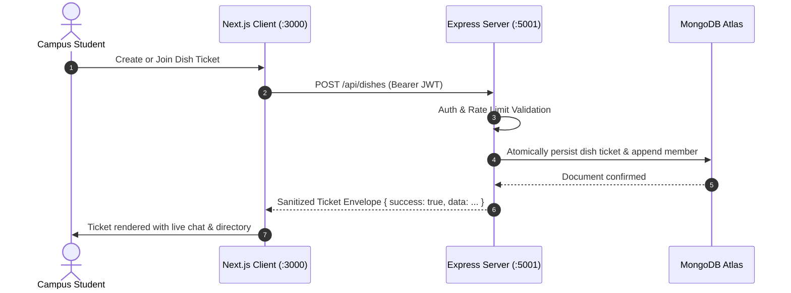

# LetMeCook

> An ephemeral, hyper-local real-world campus coordination platform designed for university students to organize spontaneous activities ("dishes") in under 30 seconds.

---

## 1. Architecture & Role in System
`LetMeCook` is a decoupled fullstack application combining an event-driven Node.js/Express backend with a modern Next.js 16 (React 19) frontend client, backed by MongoDB Atlas.

- **Frontend Client (`client/`)**: Next.js 16 with Turbopack, App Router, responsive hybrid desktop/mobile navigation, glassmorphic design system, and client-side reactive registries.
- **Backend API (`server/`)**: Express.js REST API with modular architecture (Routes $\rightarrow$ Middleware $\rightarrow$ Controllers $\rightarrow$ Services $\rightarrow$ Mongoose Models) and sub-millisecond in-memory university verification.
- **Modular Documentation**: Comprehensive developer documentation and guides maintained within each respective subfolder (`client/` and `server/`).

```
                      +-----------------------------+
                      |   Browser / Mobile Device   |
                      +--------------+--------------+
                                     |
                                     | HTTP / JSON (:3000 -> :5001)
                                     v
+------------------------------------+-------------------------------------+
|                             LetMeCook Core                               |
|                                                                          |
|   +-----------------------+                    +---------------------+   |
|   |   Next.js 16 Client   |                    |   Express Backend   |   |
|   |   - App Router (page) |                    |   - REST API Routes |   |
|   |   - Glassmorphic UI   |                    |   - Auth & RateLimit|   |
|   |   - Real-time polling |                    |   - Business Service|   |
|   +-----------+-----------+                    +----------+----------+   |
+---------------|-------------------------------------------|--------------+
                |                                           |
                | Local Storage / Memory                    | Mongoose ODM
                v                                           v
    +-----------------------+                    +---------------------+
    |  Client State Cache   |                    |    MongoDB Atlas    |
    |  - Auth Tokens & DP   |                    |  - 9 Collections    |
    |  - Message Storage    |                    |  - Auto-TTL Expiry  |
    +-----------------------+                    +---------------------+
```

---

## 2. Directory Inventory & Module Responsibilities

| Directory | Layer / Responsibility | Key Technologies | Upstream Callers |
| :--- | :--- | :--- | :--- |
| [`client/`](file:///Users/nvc/Documents/LetMeCook/client) | Web UI, App router, design system, interactive modals, client services | Next.js 16, React 19, CSS Glassmorphism | End-users (Browser) |
| [`server/`](file:///Users/nvc/Documents/LetMeCook/server) | HTTP API, authentication, dish coordination, messaging, MongoDB data access | Node.js, Express, Mongoose, JWT | Next.js Client API Gateway |

---

## 3. Data Flow & Execution Lifecycle



---

## 4. Public Contracts & Interfaces

### Core Service Ports
- **Frontend Web Server**: `http://localhost:3000`
- **Backend API Gateway**: `http://localhost:5001`
- **API Base Path**: `http://localhost:5001/api`

### Global Response Envelope
All backend endpoints conform to the strict JSON response envelope:
```json
// Success
{
  "success": true,
  "data": { ... }
}

// Error
{
  "success": false,
  "message": "Human-readable error description"
}
```

---

## 5. Key Dependencies & Requirements

- **Node.js**: `v18.0.0+` (LTS recommended)
- **Package Manager**: `npm` v9+
- **Database**: MongoDB Atlas instance (or local MongoDB 6+)
- **Environment Files**:
  - `server/.env` (Contains `PORT`, `MONGO_URI`, `JWT_SECRET`, `CLIENT_ORIGIN`)
  - `client/.env.local` (Optional: `NEXT_PUBLIC_API_URL=http://localhost:5001/api`)

---

## 6. Developer Workflows & How-Tos

### 1. Booting the Full Stack Locally

```bash
# Terminal 1: Backend API Server
cd server
npm install
npm run dev

# Terminal 2: Frontend Client
cd client
npm install
npm run dev
```

### 2. Running a Production Validation Build

```bash
# Validates TypeScript, imports, JSX syntax, and static assets
cd client
npm run build
```

---

## 7. Security, State & Performance Considerations
- **Campus Isolation**: Tickets, directory listings, and searches are partitioned by university domain (`@*.ac.in`, `@*.edu`).
- **TTL Expiry**: Dishes automatically transition to "Cooked" after duration expiry to prevent stale coordination clutter.
- **Rate Limiting**: Critical endpoints (Auth, Dish creation, Messages) are guarded by `express-rate-limit`.

---

## 8. Common Pitfalls & Debugging Gotchas
- **Port Collision**: If port `5001` or `3000` is occupied, run `lsof -i :5001 -i :3000` and kill hanging processes.
- **CORS Errors**: The backend `CLIENT_ORIGIN` in `server/.env` must match the exact frontend host (`http://localhost:3000`).
- **Database Connectivity**: Ensure your IP address is whitelisted in MongoDB Atlas Network Access.
