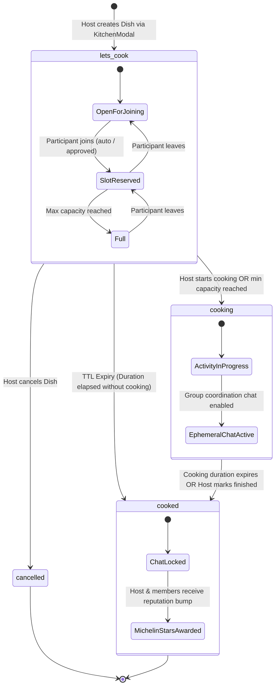
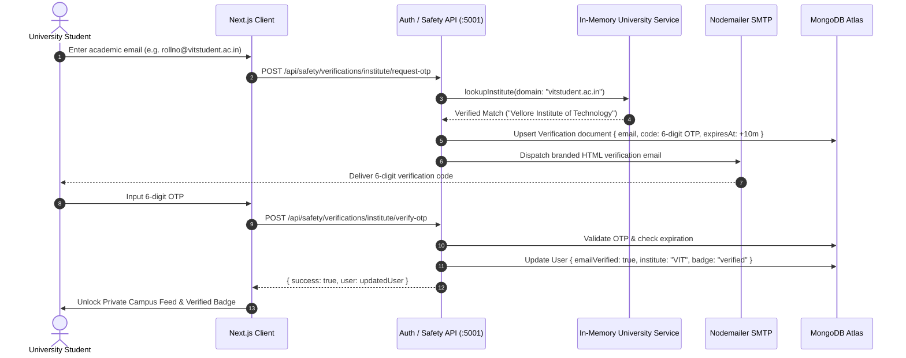

# LetMeCook

<div align="center">

```
  _             _   __  __        ____             _    
 | |    ___  __| | |  \/  | ___  / ___|___   ___  | | __
 | |   / _ \/ _` | | |\/| |/ _ \| |   / _ \ / _ \ | |/ /
 | |__|  __/ (_| | | |  | |  __/| |__| (_) | (_) ||   < 
 |_____\___|\__,_| |_|  |_|\___| \____\___/ \___/ |_|\_\
```

**An Ephemeral, Real-World Hyper-Local Campus Coordination Platform**  
*Organize spontaneous real-world activities ("Dishes") in under 30 seconds.*

[](https://nextjs.org/)
[](https://react.dev/)
[](https://nodejs.org/)
[](https://expressjs.com/)
[](https://www.mongodb.com/atlas)
[](https://tailwindcss.com/)
[](https://opensource.org/licenses/MIT)

</div>

---

## Table of Contents
1. [Executive Overview & The LetMeCook Philosophy](#1-executive-overview--the-letmecook-philosophy)
2. [Full-Stack Architecture & System Topology](#2-full-stack-architecture--system-topology)
3. [End-to-End Coordination Lifecycle & State Machines](#3-end-to-end-coordination-lifecycle--state-machines)
4. [Monorepo Directory Inventory & Module Ownership](#4-monorepo-directory-inventory--module-ownership)
5. [Complete Data Flow & Execution Lifecycle](#5-complete-data-flow--execution-lifecycle)
6. [Comprehensive REST API Surface Reference](#6-comprehensive-rest-api-surface-reference)
7. [Master Database Schema & Indexing Strategy](#7-master-database-schema--indexing-strategy)
8. [Campus Security, Privacy & Moderation Framework](#8-campus-security-privacy--moderation-framework)
9. [Reputation, Michelin Stars & Awards Engine](#9-reputation-michelin-stars--awards-engine)
10. [Local Development, Environment Setup & Workflows](#10-local-development-environment-setup--workflows)
11. [Troubleshooting & Engineering Runbook](#11-troubleshooting--engineering-runbook)

---

## 1. Executive Overview & The LetMeCook Philosophy

### 1.1 The Core Problem
College students and campus residents frequently want to engage in spontaneous activities—finding a badminton doubles partner, splitting a ride home, organizing a pickup cricket match, finding a peer to study organic chemistry with, grabbing a late-night coffee, or finding a coding buddy for a hackathon. 

Historically, this has required broadcasting uncoordinated messages across dozens of fragmented WhatsApp groups, Discord channels, Telegram broadcast threads, and personal DMs. These messages quickly get buried under chatter, lack location context, have no participant limit enforcement, and leave hosts stranded with unreliable turnouts.

### 1.2 The Ephemeral Coordination Network
**LetMeCook is not a social network.** It does not optimize for infinite scrolling, engagement farming, vanity metrics, or permanent public profiles. Instead, it is an **ephemeral, real-world coordination network** designed to answer two fundamental questions:
1. *"Who wants to do this activity with me right now?"*
2. *"What activities can I join immediately on my campus?"*

### 1.3 Key Architectural Principles
- **30-Second Time-to-Coordinate**: A host can create a "Dish" (activity ticket) with title, category, participant cap, duration, and meet location in under 30 seconds.
- **Strict Time-To-Live (TTL) Expiry**: Activities are temporary. Once the allotted cooking duration expires, the ticket automatically transitions to `cooked` and chat locks down, preventing stale listings from cluttering the feed.
- **Server-Authoritative Participant Capacity**: Slot reservation is atomic. When a Dish allows a maximum of 4 participants, the backend enforces atomic concurrency locks to prevent over-subscription.
- **Campus Domain Isolation**: Verified students automatically gain access to their university's private activity stream while still having access to a globally federated discovery scope.

---

## 2. Full-Stack Architecture & System Topology

The application is structured as a decoupled, multi-tier system with clean boundaries between presentation, business rules, data access, and persistence:

```
+-----------------------------------------------------------------------------------------+
|                                    CLIENT TIER                                          |
|                                                                                         |
|   +---------------------------------------------------------------------------------+   |
|   |                       Next.js 16 Client (Port :3000)                            |   |
|   |  - React 19 Client Components ('use client') with Turbopack Engine             |   |
|   |  - Custom Glassmorphism UI (Tailwind CSS v4 + Vanilla CSS Design Tokens)        |   |
|   |  - Single-Page Application Router with Dynamic View Switching                   |   |
|   |  - Zero-Flicker DP Sync (Custom userAvatarRegistry Pub/Sub Bus)                 |   |
|   |  - Optimistic Client Caching & Offline Fallback (messageStorage.js)             |   |
|   |  - Reactive State Hooks (useAuth, ToastContext, ConfirmContext)                 |   |
|   +---------------------------------------------------------------------------------+   |
+--------------------------------------------|--------------------------------------------+
                                             | 
                                             | HTTP / REST (JSON)
                                             | Authorization: Bearer <JWT>
                                             v
+-----------------------------------------------------------------------------------------+
|                                    SERVER TIER                                          |
|                                                                                         |
|   +---------------------------------------------------------------------------------+   |
|   |                       Express.js API Gateway (Port :5001)                       |   |
|   |  - Global Security Middleware (Helmet, CORS Origin Hardening, JSON Parser)      |   |
|   |  - Tiered Rate Limiters (authLimiter, apiLimiter, messageLimiter)                |   |
|   |  - JWT Authentication & User Hydration Middleware (auth.middleware.js)          |   |
|   |  - Schema Validation & XSS Sanitization Middleware (validator.middleware.js)   |   |
|   |  - Centralized Error Handler (error.middleware.js)                              |   |
|   +----------------------------------------|----------------------------------------+   |
|                                            |                                            |
|   +----------------------------------------v----------------------------------------+   |
|   |                       Layered Business Logic (MVC)                              |   |
|   |  - Controllers: auth, dish, user, message, connection, notification, safety    |   |
|   |  - Services: High-level transactional business logic & orchestration            |   |
|   |  - University Service: Sub-millisecond lookup across 10,000+ world colleges     |   |
|   |  - Email / OTP Service: Nodemailer-powered campus academic email verifications   |   |
|   +----------------------------------------|----------------------------------------+   |
+--------------------------------------------|--------------------------------------------+
                                             | 
                                             | Mongoose ODM (Connection Pooling & Retries)
                                             v
+-----------------------------------------------------------------------------------------+
|                                  PERSISTENCE TIER                                       |
|                                                                                         |
|   +---------------------------------------------------------------------------------+   |
|   |                       MongoDB Atlas Database Cluster                            |   |
|   |  - 9 Managed Collections: users, dishes, messages, dishmessages,               |   |
|   |                           connections, notifications, verifications,            |   |
|   |                           reports, recipes                                      |   |
|   |  - MongoDB TTL Indexes: Automatic background document expiration for OTPs       |   |
|   |  - Compound & Geospatial Indexes: Lightning queries by category, campus, status  |   |
|   +---------------------------------------------------------------------------------+   |
+-----------------------------------------------------------------------------------------+
```

---

## 3. End-to-End Coordination Lifecycle & State Machines

### 3.1 Dish Lifecycle State Machine
A Dish transitions through four distinct states during its lifespan:



1. **`lets_cook` (Recruiting / Open)**: The Dish is actively displayed on the Dine-In feed. Users can view activity details, location, and member avatars. Depending on `joinMode`:
   - `auto`: User joins immediately; slots decrement atomically.
   - `approval`: User submits a request; host receives an instant notification to approve or reject.
   - `invite_only`: Only users specifically invited by the host can participate.
2. **`cooking` (In Progress)**: The activity is currently happening in the real world. Ephemeral group chat is enabled inside the dish modal for live coordination.
3. **`cooked` (Completed / Archive)**: The activity has concluded either manually by the host or automatically via time expiration. Chat locks to read-only, and participant records contribute to user reputation.
4. **`cancelled` (Aborted)**: The host terminated the ticket before commencement. Notifications are dispatched to all joined participants.

### 3.2 Campus Verification & Domain Isolation Lifecycle



---

## 4. Monorepo Directory Inventory & Module Ownership

```
LetMeCook/
├── README.md                      # [Root] Master repository architecture manual & documentation
├── .gitignore                     # Git exclusion rules (dependencies, secrets, local guides)
├── client/                        # [Frontend] Next.js 16 Client Web Application
│   ├── README.md                  # Comprehensive Frontend Engineering Manual
│   ├── package.json               # Frontend dependencies (React 19, Lucide, Tailwind v4)
│   ├── next.config.mjs            # Next.js compiler & bundle configuration
│   ├── public/                    # Static assets, SVG icons, and default avatars
│   │   ├── README.md              # Static assets directory reference
│   │   ├── avatars/               # Stock user avatars
│   │   └── images/                # Hero banners, dish default graphics
│   └── src/                       # Application source code
│       ├── README.md              # Client source code overview
│       ├── app/                   # Next.js App Router entrypoints
│       │   ├── README.md          # App router, page controller & globals documentation
│       │   ├── layout.js          # Root HTML layout, font setup, and providers
│       │   ├── page.js            # Master SPA view controller (136KB, reactive state)
│       │   └── globals.css        # Glassmorphism design tokens & responsive CSS rules
│       ├── components/            # UI components and feature modular views
│       │   ├── README.md          # Component catalog and design guidelines
│       │   ├── ui/                # Base primitives (FluidButton, GlassContainer, ResponseToast)
│       │   ├── layout/            # Layout shells (Desktop Sidebar, MobileNav)
│       │   ├── home/              # Dashboard view, hero banners, trending dish carousel
│       │   ├── dish/              # DishCard, DishDetailModal (chat, members, controls)
│       │   ├── dinein/            # Multi-category searchable activity feed
│       │   ├── kitchen/           # KitchenModal (Dish creation wizard)
│       │   ├── messaging/         # ConversationList, MessageArea, EmojiPicker
│       │   ├── notifications/     # NotificationsView (activity & request cards)
│       │   ├── profile/           # ProfileHeader, AwardsLibrary (Michelin stars)
│       │   ├── search/            # GlobalSearchModal (debounced omnibox search)
│       │   ├── settings/          # SettingsPage (account, privacy, safety controls)
│       │   └── global/            # GlobalPage (inter-campus discovery feed)
│       ├── constants/             # Enums, activity categories, tab keys
│       ├── context/               # React Contexts (ToastContext, ConfirmContext)
│       ├── hooks/                 # Custom React hooks (useAuth session management)
│       ├── lib/                   # Utility libraries (api.js, userAvatarRegistry, messageStorage)
│       └── services/              # Client API gateway clients (auth, dish, user, message, connection)
│
└── server/                        # [Backend] Express.js REST API Server
    ├── README.md                  # Comprehensive Backend Engineering Manual
    ├── package.json               # Backend dependencies (Express, Mongoose, JWT, Nodemailer)
    ├── .env                       # Backend local secrets (MongoDB URI, JWT secret, Ports)
    └── src/                       # Backend source code
        ├── README.md              # Server source code overview
        ├── server.js              # Entrypoint (Express init, middleware mounting, DB boot)
        ├── config/                # Environment & Database connectors (db.js)
        ├── middleware/            # Security, Auth, Validation, Rate Limiting, Error handling
        ├── models/                # Mongoose schemas (User, Dish, Message, Notification, etc.)
        ├── controllers/           # HTTP request/response handlers
        ├── services/              # Transactional business logic & external integrations
        ├── routes/                # Express router declarations
        ├── data/                  # Static datasets (world_universities.json - 10,000+ schools)
        └── utils/                 # Validators, seeders, helpers
```

---

## 5. Complete Data Flow & Execution Lifecycle

The diagram below details the complete execution lifecycle when an authenticated student creates a new Dish and other students join:

```mermaid
sequenceDiagram
    autonumber
    actor Host as Host Student
    actor Participant as Joining Student
    participant UI as Next.js Client (:3000)
    participant GW as Express Gateway (:5001)
    participant Rate as rateLimit.middleware
    participant Auth as auth.middleware
    participant Val as validator.middleware
    participant Ctrl as dish.controller
    participant Svc as dish.service
    participant DB as MongoDB Atlas

    %% Step 1: Dish Creation
    Host->>UI: Fills KitchenModal form & clicks "Start Cooking"
    UI->>GW: POST /api/dishes (Bearer JWT + Dish Payload)
    GW->>Rate: Check dishLimiter (Max 10 per 15m)
    Rate->>Auth: Extract & verify JWT token
    Auth->>Val: Validate createDishValidator schema
    Val->>Ctrl: invoke createDish(req, res)
    Ctrl->>Svc: invoke dishService.createDish(userId, payload)
    Svc->>DB: Calculate expiresAt = Date.now() + duration
    Svc->>DB: Dish.create({ creator: userId, participants: [creator], ... })
    DB-->>Svc: Persisted Dish Document
    Svc-->>Ctrl: Sanitized Dish DTO
    Ctrl-->>UI: 201 Created { success: true, data: dish }
    UI->>Host: Toast: "Dish is now Cooking!" + Refresh Dine-In Feed

    %% Step 2: Discovery & Joining
    Participant->>UI: Browses Dine-In Feed & clicks "Join Dish"
    UI->>GW: POST /api/dishes/:id/join (Bearer JWT)
    GW->>Auth: Verify Participant JWT
    Auth->>Ctrl: invoke joinDish(req, res)
    Ctrl->>Svc: invoke dishService.joinDish(dishId, participantId)
    Svc->>DB: Atomic Query: Dish.findById(dishId)
    alt Dish is Full (participants.length >= capacity.max)
        Svc-->>Ctrl: Throw Error ("Dish is at maximum capacity")
        Ctrl-->>UI: 400 Bad Request { success: false, message: "Dish is full" }
    else Slot Available
        Svc->>DB: Atomic Update: $push participants { user: participantId }
        Svc->>DB: Notification.create({ recipient: creator, type: "dish_joined" })
        DB-->>Svc: Updated Dish Document
        Svc-->>Ctrl: Updated Dish DTO
        Ctrl-->>UI: 200 OK { success: true, data: dish }
        UI->>Participant: Open DishDetailModal with live group chat enabled!
    end
```

---

## 6. Comprehensive REST API Surface Reference

All endpoints are hosted under the base prefix `/api`. Protected routes require standard HTTP header:  
`Authorization: Bearer <jwt_token>`

### 6.1 Authentication (`/api/auth`)
| Method | Endpoint | Access | Description |
| :--- | :--- | :--- | :--- |
| `POST` | `/api/auth/register` | Public | Create new student account (validates unique username, email, phone). |
| `POST` | `/api/auth/login` | Public (Rate-Limited) | Authenticate credentials; returns signed JWT and sanitized user profile. |
| `GET` | `/api/auth/me` | Protected | Hydrate currently authenticated user profile from token context. |
| `POST` | `/api/auth/change-password` | Protected | Update account password after verifying previous hash. |

### 6.2 Dishes & Coordination (`/api/dishes`)
| Method | Endpoint | Access | Description |
| :--- | :--- | :--- | :--- |
| `GET` | `/api/dishes` | Public / Hybrid | Fetch active dishes. Filters: `?category=`, `?status=`, `?scope=`. |
| `GET` | `/api/dishes/:id` | Public / Hybrid | Retrieve full dish details including populated host & participants. |
| `POST` | `/api/dishes` | Protected | Spawn a new dish ticket with duration, capacity, and join rules. |
| `POST` | `/api/dishes/:id/join` | Protected | Join an active dish (auto-joins or enqueues join request). |
| `POST` | `/api/dishes/:id/leave` | Protected | Leave an active dish; frees capacity slot atomically. |
| `PATCH` | `/api/dishes/:id/status` | Protected (Host) | Manually transition dish state (`lets_cook` $\rightarrow$ `cooking` $\rightarrow$ `cooked`). |
| `DELETE`| `/api/dishes/:id` | Protected (Host) | Terminate and delete an active dish ticket. |
| `GET` | `/api/dishes/:id/chat` | Protected (Members) | Retrieve historical ephemeral group messages for this dish. |
| `POST` | `/api/dishes/:id/chat/messages`| Protected (Members) | Dispatch live message into dish group chat. |
| `POST` | `/api/dishes/:id/kick` | Protected (Host) | Eject an abusive participant from the dish. |
| `POST` | `/api/dishes/:id/mute` | Protected (Host) | Silence a disruptive participant in the dish chat. |

### 6.3 Direct Messaging (`/api/messages`)
| Method | Endpoint | Access | Description |
| :--- | :--- | :--- | :--- |
| `GET` | `/api/messages/conversations` | Protected | List all 1-on-1 conversations with latest message snippet and unread count. |
| `GET` | `/api/messages/conversations/:id` | Protected | Retrieve full message history with pagination between two users. |
| `POST` | `/api/messages` | Protected (Rate-Limited) | Send direct message (creates conversation thread if nonexistent). |
| `POST` | `/api/messages/requests/:id/respond`| Protected | Accept or decline direct message request from an unverified peer. |

### 6.4 Campus Verifications & Safety (`/api/safety`)
| Method | Endpoint | Access | Description |
| :--- | :--- | :--- | :--- |
| `GET` | `/api/safety/verifications/institute/lookup` | Protected | Live lookup of university domain against 10,000+ university registry. |
| `POST` | `/api/safety/verifications/institute/request-otp` | Protected | Send 6-digit cryptographic verification code to academic email. |
| `POST` | `/api/safety/verifications/institute/verify-otp` | Protected | Verify code, award verified status, and link university domain. |
| `POST` | `/api/safety/reports` | Protected | Submit trust & safety report against user, dish, or message. |
| `GET` | `/api/safety/my-reports` | Protected | Audit history of reports filed by current user. |

### 6.5 Connections & Social Graph (`/api/connections`)
| Method | Endpoint | Access | Description |
| :--- | :--- | :--- | :--- |
| `GET` | `/api/connections` | Protected | List mutual campus friends / connections. |
| `GET` | `/api/connections/requests` | Protected | List pending inbound connection requests. |
| `POST` | `/api/connections/:userId` | Protected | Send connection invite to another student. |
| `DELETE`| `/api/connections/:userId` | Protected | Break existing connection or cancel pending request. |
| `POST` | `/api/connections/:id/respond` | Protected | Accept or reject inbound connection request. |

### 6.6 User Management & Privacy (`/api/users`)
| Method | Endpoint | Access | Description |
| :--- | :--- | :--- | :--- |
| `PATCH`| `/api/users/me` | Protected | Update personal profile (bio, interests, avatar, privacy levels). |
| `GET` | `/api/users/search` | Public / Hybrid | Search users by name, username, or campus interests. |
| `GET` | `/api/users/:username` | Public / Hybrid | Fetch public profile conforming to target's privacy settings. |
| `POST` | `/api/users/me/block` | Protected | Add user to blocklist (hides all dishes, messages, and profile). |
| `DELETE`| `/api/users/me/block/:username`| Protected | Remove user from active blocklist. |

---

## 7. Master Database Schema & Indexing Strategy

### 7.1 Schema Architecture Summary
LetMeCook enforces a clean relational-like document model in MongoDB with strict validation:

```
+--------------------+        +--------------------+        +--------------------+
|       Users        |        |       Dishes       |        |    DishMessages    |
+--------------------+        +--------------------+        +--------------------+
| _id                |<-------| creator            |<-------| dishId             |
| username (unique)  |        | category           |        | senderId           |
| email (unique)     |        | status             |        | content            |
| institute          |        | timing {start,end} |        | createdAt          |
| stats {cooked,star}|        | capacity {max}     |        +--------------------+
| privacy {...}      |        | participants [{..}]|
+--------------------+        +--------------------+
          |                             |
          v                             v
+--------------------+        +--------------------+
|      Messages      |        |   Notifications    |
+--------------------+        +--------------------+
| conversationId     |        | recipient          |
| senderId           |        | type (enum)        |
| recipientId        |        | data (ref id)      |
| content            |        | read (boolean)     |
+--------------------+        +--------------------+
```

### 7.2 Core Collections Specification

#### `users`
- **Unique Indexes**: `username` (lowercase), `email` (lowercase), `mobile`
- **Fields**:
  - `name`: String (max 60)
  - `passwordHash`: String (Argon2 / bcrypt, `select: false`)
  - `emailVerified`: Boolean
  - `avatar`: URL / Base64 string
  - `bio`: String (max 160)
  - `interests`: Array of Strings (tags)
  - `institute`: Object `{ name, domain, verified, verifiedAt }`
  - `privacy`: Object `{ showEmail, showMobile, allowDMs, profileVisibility }`
  - `stats`: Object `{ dishesCreated, dishesJoined, michelinStars, reputationPoints }`

#### `dishes`
- **Compound Indexes**: `{ category: 1, status: 1 }`, `{ 'timing.cookEnd': 1 }`, `{ creator: 1 }`
- **Fields**:
  - `creator`: ObjectId (ref: `User`)
  - `type`: Enum `['regular', 'chefs_special']`
  - `description`: String (max 500)
  - `category`: Enum `['sport', 'study', 'travel', 'food', 'gaming', 'social', 'help', 'learning', 'other']`
  - `status`: Enum `['lets_cook', 'cooking', 'cooked']`
  - `timing`: Object `{ cookStart, cookEnd, cookingStart, cookingEnd }`
  - `capacity`: Object `{ max: Number (default 4), unlimited: Boolean }`
  - `joinMode`: Enum `['auto', 'approval', 'invite_only']`
  - `participants`: Array of Subdocuments `[{ user: ObjectId, joinedAt, role: 'creator'|'participant' }]`
  - `location`: Object `{ label: String, coordinates: [lng, lat] }`

#### `verifications`
- **TTL Index**: `expiresAt` with `expireAfterSeconds: 0` (Mongo automatically purges expired OTPs)
- **Fields**:
  - `email`: String (lowercase)
  - `code`: String (hashed 6-digit OTP)
  - `type`: Enum `['institute_email', 'password_reset', 'mobile']`
  - `attempts`: Number (max 5 attempts before lockout)
  - `expiresAt`: Date (created + 10 minutes)

---

## 8. Campus Security, Privacy & Moderation Framework

### 8.1 Server-Authoritative Security
The client is strictly treated as an untrusted environment. All permissions, capacity checks, and privacy sanitizations are enforced strictly on the server:
- **Sensitive PII Scrubbing**: User email addresses, phone numbers, and exact passwords never leave the database without explicit user permission. The Mongoose `select: false` attribute guarantees `passwordHash` is excluded from general queries.
- **Privacy Tiers**: Profile details are masked based on the viewer's relationship (Mutual Connection vs Verified Campus Peer vs Unverified Guest).
- **Rate Limiting Hardening**:
  - `authLimiter`: 10 requests per 15 minutes per IP (prevents credential stuffing).
  - `apiLimiter`: 120 requests per minute per IP (prevents DDoS and scraping).
  - `messageLimiter`: 30 messages per minute (prevents spam flooding).

### 8.2 Safety, Blocking & Reporting
Students maintain full autonomy over their safety:
1. **Instant User Blocking**: Blocking a user immediately severs connection graphs, hides all active dishes created by that user, and prevents them from seeing or joining dishes created by the blocker.
2. **Abusive Dish Moderation**: Hosts have full administrative authority over their dish: they can kick disruptive participants, mute noisy users in chat, or delete the dish entirely.
3. **Structured Reports**: Users can flag harassment, impersonation, or dangerous activities with categorized tags (`harassment`, `spam`, `safety`, `inappropriate`). Reports are filed directly to `/api/safety/reports` for administrative triage.

---

## 9. Reputation, Michelin Stars & Awards Engine

To foster high reliability and discourage ghosting in real-world meetups, LetMeCook implements a culinary-themed trust metric:

| Reputation Tier | Minimum Requirement | Platform Privileges |
| :--- | :--- | :--- |
| **Apprentice Cook** | 0 Completed Dishes | Standard dish creation & participation (Max 4 people). |
| **Sous Chef (★)** | 5+ Successfully Cooked Dishes | Verified campus badge, can create dishes with up to 10 participants. |
| **Executive Chef (★★)** | 20+ Completed Dishes, 0 No-Show Flags | Priority placement on Campus Trending carousel, unlocked "Chef's Special" tags. |
| **Michelin Star Master (★★★)**| 50+ Completed Dishes, High Peer Trust | Campus community ambassador, unlimited dish capacity, custom vanity badges. |

Reputation points are dynamically computed based on dish completion frequency, participant retention, and peer vouching.

---

## 10. Local Development, Environment Setup & Workflows

### 10.1 Prerequisites
- **Node.js**: `v18.0.0` or higher (LTS recommended)
- **Package Manager**: `npm` v9+ or `yarn` / `pnpm`
- **Database**: Active MongoDB Atlas Cluster URI or local MongoDB Community Server `v6.0+`

### 10.2 Step-by-Step Installation

#### 1. Clone the Repository
```bash
git clone https://github.com/soelnvc/LetMeCook.git
cd LetMeCook
```

#### 2. Configure Backend (`server/`)
Navigate to the server directory and create your `.env` configuration:
```bash
cd server
cp .env.example .env # Or create .env directly
```
Ensure your `server/.env` contains the required keys:
```env
PORT=5001
NODE_ENV=development
MONGO_URI=mongodb+srv://<username>:<password>@cluster0.mongodb.net/letmecook?retryWrites=true&w=majority
JWT_SECRET=super_secret_jwt_cryptographic_key_minimum_32_characters
CLIENT_ORIGIN=http://localhost:3000
SMTP_HOST=smtp.gmail.com
SMTP_PORT=587
SMTP_USER=your_campus_mailer@gmail.com
SMTP_PASS=your_app_specific_password
```
Install dependencies and launch the dev server:
```bash
npm install
npm run dev
# Server will boot on http://localhost:5001
```

#### 3. Configure Frontend (`client/`)
In a new terminal window, navigate to `client/`:
```bash
cd client
```
Optional: create `client/.env.local` if using custom ports:
```env
NEXT_PUBLIC_API_URL=http://localhost:5001/api
```
Install dependencies and launch the Next.js Turbopack development server:
```bash
npm install
npm run dev
# Frontend will boot on http://localhost:3000
```

### 10.3 Useful Developer Scripts
```bash
# Frontend (in client/)
npm run dev       # Starts Next.js development server with Turbopack
npm run build     # Builds and validates production bundle
npm run lint      # Analyzes JSX and JavaScript for lint issues

# Backend (in server/)
npm run dev       # Starts Express backend via nodemon (hot reloading)
npm start         # Runs production server (node src/server.js)
```

---

## 11. Troubleshooting & Engineering Runbook

### 1. Port In Use (`EADDRINUSE: 5001` or `3000`)
If another background process or dangling node worker is occupying the required ports:
```bash
# Locate and terminate the process holding port 5001 or 3000
lsof -i :5001 -i :3000
kill -9 <PID>
```

### 2. CORS Policy Violations
If browser console reports: `Access to fetch at ... has been blocked by CORS policy`:
- Verify `CLIENT_ORIGIN` in `server/.env` is set to the exact protocol and host of your frontend:
  ```env
  CLIENT_ORIGIN=http://localhost:3000
  ```
- If testing from mobile or LAN, add your local IP to the CORS whitelist in `server/src/server.js`.

### 3. MongoDB Atlas Connection Timeout (`MongooseServerSelectionError`)
- Ensure your current public IP address is added to the **Network Access IP Whitelist** in your MongoDB Atlas dashboard (or allow `0.0.0.0/0` during development).
- Check that your database user has `readWriteAnyDatabase` privileges.

### 4. JWT Token Expiration & Stale Sessions
If API calls return persistent `401 Unauthorized`:
- Open browser DevTools $\rightarrow$ Application $\rightarrow$ Local Storage.
- Clear the `token` key or invoke `localStorage.removeItem('token')`.
- Log in again to obtain a freshly signed JWT token.

---

<div align="center">
  <sub>Built with passion for real-world spontaneous human coordination. © LetMeCook Team.</sub>
</div>
