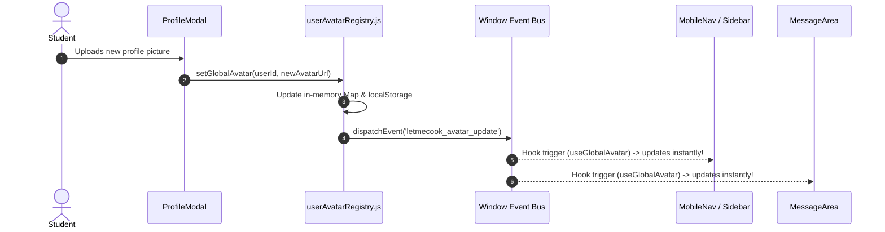

# LetMeCook — Frontend Engineering Manual (`client/`)

<div align="center">

```
   ____ _ _            _     _   _ ___ 
  / ___| (_) ___ _ __ | |_  | | | |_ _|
 | |   | | |/ _ \ '_ \| __| | | | || | 
 | |___| | |  __/ | | | |_  | |_| || | 
  \____|_|_|\___|_| |_|\__|  \___/|___|
```

**Next.js 16 (React 19) Glassmorphic Web Client for Real-World Coordination**

[](https://nextjs.org/)
[](https://react.dev/)
[](https://tailwindcss.com/)
[](https://lucide.dev/)
[](https://turbo.build/pack)

</div>

---

## Table of Contents
1. [Frontend Architecture Overview](#1-frontend-architecture-overview)
2. [Component Tree & Application Layout](#2-component-tree--application-layout)
3. [Master View Controller & Navigation States](#3-master-view-controller--navigation-states)
4. [Component Catalog & Feature Modules](#4-component-catalog--feature-modules)
5. [Interactive Overlays & Modals](#5-interactive-overlays--modals)
6. [Design System & Glassmorphism Tokens](#6-design-system--glassmorphism-tokens)
7. [State Management, Caching & Data Sync](#7-state-management-caching--data-sync)
8. [API Services Layer Specification](#8-api-services-layer-specification)
9. [Developer Workflows, Build & Optimization](#9-developer-workflows-build--optimization)
10. [Frontend Debugging & Edge-Case Runbook](#10-frontend-debugging--edge-case-runbook)

---

## 1. Frontend Architecture Overview

The `client/` application is an ultra-fast, ephemeral Single Page Application (SPA) designed to enable real-world campus coordination in under 30 seconds. Built with **Next.js 16 (App Router)** and **React 19**, it utilizes client-side reactive rendering (`'use client'`) powered by the **Turbopack** compilation engine.

### Core Technology Stack
- **Framework**: [Next.js 16.3.8](https://nextjs.org/) (App Router, Turbopack, dynamic client routing)
- **Runtime / UI Core**: [React 19.2.8](https://react.dev/) (Hooks, dynamic concurrent rendering, Context API)
- **Styling Architecture**: Custom Glassmorphism design system built on **Tailwind CSS v4** + Vanilla CSS variables (`globals.css`)
- **Iconography**: [Lucide React 1.51.0](https://lucide.dev/)
- **Network Client**: Custom fetch wrapper (`lib/api.js`) with automatic JWT injection and 401 interceptors
- **State Engines**: React Context (`ToastContext`, `ConfirmContext`) + isolated `localStorage` offline messaging engine + custom reactive Pub/Sub avatar synchronization (`userAvatarRegistry.js`).

---

## 2. Component Tree & Application Layout

The frontend uses a unified master layout architecture that seamlessly transforms between Desktop and Mobile form factors:

```
+----------------------------------------------------------------------------------------------------+
|                                      RootLayout (src/app/layout.js)                                 |
|  - Injects Google Fonts ('Inter')                                                                   |
|  - ToastProvider (Global response notifications)                                                    |
|  - ConfirmProvider (Custom confirmation dialogs)                                                    |
+----------------------------------------------------------------------------------------------------+
                                                  |
                                                  v
+----------------------------------------------------------------------------------------------------+
|                                    PageController (src/app/page.js)                                |
|  - Manages active tab state: ['home', 'dine-in', 'messages', 'notifications', 'profile', ...]      |
|  - Real-time polling timers (Dishes, Notifications, Active Conversation, Verification)             |
|  - Global modal open states (KitchenModal, DishDetailModal, GlobalSearchModal, ProfileModal)        |
+----------------------------------------------------------------------------------------------------+
       |                                                                               |
       | Desktop Viewports (>= 769px)                                                 | Mobile Viewports (<= 768px)
       v                                                                               v
+------------------------------------+                               +------------------------------------+
| Sidebar (Desktop)                  |                               | MobileNav (Mobile Fixed Shell)     |
| - Collapsed: 64px icon bar         |                               | - Fixed Top Bar: Logo, Campus Pill |
| - Expanded: 210px with text labels |                               | - Fixed Bottom Bar: 5-Tab Icon Dock|
| - Kitchen Trigger ("Cook Dish")    |                               | - Floating Action Kitchen Trigger  |
+------------------------------------+                               +------------------------------------+
       |                                                                               |
       +---------------------------------------+---------------------------------------+
                                               |
                                               v
+----------------------------------------------------------------------------------------------------+
|                                      Dynamic View Mount Point                                       |
|                                                                                                     |
|   +-----------------------+   +-----------------------+   +-------------------------------------+   |
|   | HomeDashboard.jsx     |   | DineInFeed.jsx        |   | MessageArea.jsx                     |   |
|   | - Hero Banner         |   | - Category Filter Bar |   | - ConversationList.jsx (DMs)        |   |
|   | - Quick Action Pills  |   | - Multi-Scope Selector|   | - Live Message Bubbles              |   |
|   | - Trending Carousel   |   | - DishCard.jsx Grids  |   | - EmojiPicker.jsx / Quick Prompts   |   |
|   +-----------------------+   +-----------------------+   +-------------------------------------+   |
|   +-----------------------+   +-----------------------+   +-------------------------------------+   |
|   | NotificationsView.jsx |   | ProfileHeader.jsx     |   | SettingsPage.jsx                    |   |
|   | - Inbound Join Cards  |   | - Campus Domain Badge |   | - Account & Academic Email OTP      |   |
|   | - Approve / Reject    |   | - AwardsLibrary.jsx   |   | - Privacy Controls & Safety Lists   |   |
|   +-----------------------+   +-----------------------+   +-------------------------------------+   |
+----------------------------------------------------------------------------------------------------+
                                               |
                                               v
+----------------------------------------------------------------------------------------------------+
|                                   Global Modal Overlays (Portals)                                  |
|  - KitchenModal.jsx: Dish creation wizard with timing slider and slot controls                     |
|  - DishDetailModal.jsx: Ephemeral group chat, live roster, join/leave and host actions             |
|  - GlobalSearchModal.jsx: Real-time debounced search across dishes, peers, and universities        |
|  - CustomConfirmModal.jsx: High-contrast modal for destructive confirmations                       |
+----------------------------------------------------------------------------------------------------+
```

---

## 3. Master View Controller & Navigation States

The master state controller is housed in [`src/app/page.js`](file:///Users/nvc/Documents/LetMeCook/client/src/app/page.js). It maintains the active view tab through the `activeTab` state variable:

| `activeTab` Value | Rendered View | Functionality & Scope |
| :--- | :--- | :--- |
| `'home'` | [`HomeDashboard`](file:///Users/nvc/Documents/LetMeCook/client/src/components/home/HomeDashboard.jsx) | Welcoming hero banner, quick category jump pills, active campus trending dishes carousel. |
| `'dine-in'` | [`DineInFeed`](file:///Users/nvc/Documents/LetMeCook/client/src/components/dinein/DineInFeed.jsx) | The primary activity coordination feed. Filterable by category, status, and campus scope. |
| `'messages'` | [`MessageArea`](file:///Users/nvc/Documents/LetMeCook/client/src/components/messaging/MessageArea.jsx) | Full-featured 1-on-1 direct messaging, conversation switcher, requests inbox, emoji picker. |
| `'notifications'`| [`NotificationsView`](file:///Users/nvc/Documents/LetMeCook/client/src/components/notifications/NotificationsView.jsx) | Activity log, inbound join requests with 1-click Approve/Reject, and peer invites. |
| `'profile'` | [`ProfileHeader`](file:///Users/nvc/Documents/LetMeCook/client/src/components/profile/ProfileHeader.jsx) | Personal stats, active cooked dishes, joined history, and Michelin Star Awards library. |
| `'settings'` | [`SettingsPage`](file:///Users/nvc/Documents/LetMeCook/client/src/components/settings/SettingsPage.jsx) | Academic institute verification (OTP flow), privacy toggles, blocked peers management. |
| `'global'` | [`GlobalPage`](file:///Users/nvc/Documents/LetMeCook/client/src/components/global/GlobalPage.jsx) | Federated cross-campus activity discovery for finding inter-college events and trips. |

---

## 4. Component Catalog & Feature Modules

### 4.1 Layout Components (`src/components/layout/`)
- [`Sidebar.jsx`](file:///Users/nvc/Documents/LetMeCook/client/src/components/layout/Sidebar.jsx):
  - Desktop-only expanding navigation bar (`min-width: 769px`).
  - Smooth CSS transition between compact 64px icon bar and expanded 210px labeled menu.
  - Prominent "Cook" quick-action button triggering the `KitchenModal`.
  - Floating indicator tooltips with custom cubic bezier easing.
- [`MobileNav.jsx`](file:///Users/nvc/Documents/LetMeCook/client/src/components/layout/MobileNav.jsx):
  - Fixed mobile header (`max-width: 768px`) with logo, verified campus badge, omnibox search trigger, and notifications bell with live unread counter.
  - Docked 5-tab bottom navigation bar (`Home`, `Dine-In`, `Cook (Fab)`, `Messages`, `Profile`) with frosted backdrop-blur and active indicator glow.

### 4.2 Dish & Coordination Components (`src/components/dish/`)
- [`DishCard.jsx`](file:///Users/nvc/Documents/LetMeCook/client/src/components/dish/DishCard.jsx):
  - Glassmorphic card rendering activity title, category badge, host avatar, and expiration countdown.
  - Dynamic participant avatar stack displaying joined members and remaining open slots.
  - Status pill (`lets_cook` in vibrant emerald, `cooking` in amber, `cooked` in muted slate).
- [`DishDetailModal.jsx`](file:///Users/nvc/Documents/LetMeCook/client/src/components/dish/DishDetailModal.jsx):
  - Complete coordination hub for an active dish.
  - **Live Ephemeral Group Chat**: Real-time message list for participants with auto-scroll and send input.
  - **Member Roster**: Displays all participants, host star ratings, and verified campus badges.
  - **Host Controls**: Start Cooking, Mark Cooked, Kick Abusive Member, Mute Participant, or Delete Dish.
  - **Participant Actions**: 1-click Join, Leave Dish, or Share coordination link.

### 4.3 Kitchen & Creation Wizard (`src/components/kitchen/`)
- [`KitchenModal.jsx`](file:///Users/nvc/Documents/LetMeCook/client/src/components/kitchen/KitchenModal.jsx):
  - Multi-step modal allowing students to publish a Dish in under 30 seconds.
  - Category selector: Sport, Study, Travel, Gaming, Social, Help, Learning, Food, Other.
  - Dynamic duration selector (30 minutes to 24 hours) calculating exact `cookEnd` timestamps.
  - Capacity counter: Max participants (2 to 20 or unlimited).
  - Join Mode toggle: Auto-Join vs Host Approval Required.
  - Privacy Scope: Campus Verified Only vs Global Public.

### 4.4 Messaging Subsystem (`src/components/messaging/`)
- [`ConversationList.jsx`](file:///Users/nvc/Documents/LetMeCook/client/src/components/messaging/ConversationList.jsx):
  - Searchable conversation sidebar with unread message badges.
  - Dual tab view: Direct Messages vs Inbound Message Requests.
  - Dedicated fallback caching preventing blank conversation lists during network delays.
- [`MessageArea.jsx`](file:///Users/nvc/Documents/LetMeCook/client/src/components/messaging/MessageArea.jsx):
  - Live message stream with bubble styling matching glassmorphic design language.
  - Optimistic UI updates: Outgoing messages render instantly before network roundtrips.
- [`EmojiPicker.jsx`](file:///Users/nvc/Documents/LetMeCook/client/src/components/messaging/EmojiPicker.jsx):
  - Popover emoji palette with categorized campus coordination emojis.

---

## 5. Interactive Overlays & Modals

### 5.1 Global Search Omnibox (`src/components/search/GlobalSearchModal.jsx`)
- Activated globally via `Cmd + K` (Mac) / `Ctrl + K` (Windows) or the search icon in the header.
- Debounced auto-complete searching across:
  1. Active dishes (by title, category, description, and tags)
  2. Campus peers (by name, username, and verified university)
  3. University registry (10,000+ colleges)
- Keyboard navigable (Arrow keys + Enter to select).

### 5.2 UI Primitives (`src/components/ui/`)
- [`FluidButton.jsx`](file:///Users/nvc/Documents/LetMeCook/client/src/components/ui/FluidButton.jsx): Liquid-feel interactive button with dynamic SVG gooey filters, hover glare, and haptic spring animations.
- [`GlassContainer.jsx`](file:///Users/nvc/Documents/LetMeCook/client/src/components/ui/GlassContainer.jsx): Standard frosted glass panel with 1px border highlight and configurable blur depth.
- [`ResponseToast.jsx`](file:///Users/nvc/Documents/LetMeCook/client/src/components/ui/ResponseToast.jsx): Centered glassmorphic toast notification for system feedback, errors, and approvals.
- [`CustomConfirmModal.jsx`](file:///Users/nvc/Documents/LetMeCook/client/src/components/ui/CustomConfirmModal.jsx): High-contrast confirmation modal for destructive operations (leaving dish, deleting dish, blocking user).

---

## 6. Design System & Glassmorphism Tokens

All visual styles are governed by custom CSS tokens declared in [`src/app/globals.css`](file:///Users/nvc/Documents/LetMeCook/client/src/app/globals.css):

```css
:root {
  /* Fluid Cubic Easing Curves */
  --f-cubic: cubic-bezier(0.35, 0.35, 0, 1);
  --f-cubic-in: cubic-bezier(0.69, 0, 0, 1);
  --f-fast: cubic-bezier(0, 0.81, 0.35, 1);
  --f-smooth: cubic-bezier(0.5, 0, 0.3, 1);
  --f-bounce: cubic-bezier(0.6, 0.5, 0, 3);

  /* Curated Color Palette */
  --c-grey: #e6dfe4;
  --c-grey-rgb: 230, 223, 228;
  --c-grey-dark: #544d56;
  --c-grey-dark-rgb: 84, 77, 86;
  --c-black: #101214;
  --c-black-rgb: 16, 18, 20;
  --c-white: #ffffff;
  --c-white-rgb: 255, 255, 255;
}
```

### Responsive Breakpoint Strategy
- **Mobile (`max-width: 768px`)**:
  - Desktop sidebar is completely hidden (`display: none`).
  - Fixed mobile top navbar and bottom 5-tab docked bar are mounted.
  - Feeds collapse into a single high-readability column with 100% card widths.
  - Modals convert into bottom sheets or full-screen overlays with swipe-to-dismiss headers.
- **Desktop (`min-width: 769px`)**:
  - Expanding sidebar active on left edge (`w-[64px]` default, `w-[210px]` on hover/expand).
  - Feeds render in multi-column responsive grid (`grid-cols-2` / `grid-cols-3`).
  - Modals render centered with floating glass backdrop filters (`backdrop-blur-md`).

---

## 7. State Management, Caching & Data Sync

### 7.1 Zero-Flicker Global Avatar Sync (`src/lib/userAvatarRegistry.js`)
In typical web apps, when a user changes their profile photo, other open components (navigation bars, chat messages, active cards) retain the old photo until a hard refresh. LetMeCook solves this with `userAvatarRegistry`:
- Maintains an in-memory `Map` keyed by `username` and `userId`.
- Emits a custom window event (`letmecook_avatar_update`) whenever an avatar changes.
- Provides the `useGlobalAvatar(userOrKey)` hook: components subscribed to this hook automatically re-render without flickering.



### 7.2 Per-User Isolated Message Caching (`src/lib/messageStorage.js`)
To guarantee instant zero-latency loading when opening conversations:
- Isolates storage keys by user ID: `letmecook_${userId}_conversations` and `letmecook_${userId}_messages`.
- Automatically deduplicates conversations so that a user never has split or duplicate threads with the same peer.
- Performs seamless conversation ID migration when temporary client-generated IDs are replaced by server database IDs upon sending the initial message.

### 7.3 Real-Time Background Polling
In `src/app/page.js`, background polling loops maintain fresh state without requiring resource-heavy persistent socket tunnels:
- **Dishes Feed**: Polls every 12 seconds when the user is on the `home` or `dine-in` tab.
- **Notifications**: Polls every 15 seconds to fetch new join requests and approvals.
- **Active Chat**: Polls every 3.5 seconds when `DishDetailModal` or `MessageArea` is open.

---

## 8. API Services Layer Specification

All server communications flow through typed service wrappers located in [`src/services/`](file:///Users/nvc/Documents/LetMeCook/client/src/services):

| Service | File | Primary Methods & Responsibilities |
| :--- | :--- | :--- |
| **`authService`** | `auth.service.js` | `login()`, `register()`, `getMe()`, `logout()`. Stores JWT in `localStorage`. |
| **`dishService`** | `dish.service.js` | `getDishes(filters)`, `getDishById(id)`, `createDish(payload)`, `joinDish(id)`, `leaveDish(id)`, `updateStatus(id, status)`, `deleteDish(id)`, `getDishChat(id)`, `sendChatMessage(id, msg)`. |
| **`messageService`**| `message.service.js`| `getConversations()`, `getMessages(convId)`, `sendMessage(recipientId, text)`, `respondToRequest(convId, action)`. |
| **`userService`** | `user.service.js` | `updateProfile(data)`, `getPublicProfile(username)`, `searchUsers(query)`. |
| **`connectionService`**| `connection.service.js`| `getConnections()`, `getRequests()`, `sendRequest(userId)`, `removeConnection(userId)`. |

---

## 9. Developer Workflows, Build & Optimization

### 9.1 Local Development
```bash
cd client
npm install
npm run dev
# Starts Turbopack dev server on http://localhost:3000
```

### 9.2 Production Build & Validation
```bash
npm run build
# Compiles App Router pages, validates JSX syntax, and verifies CSS tokens
```

### 9.3 Code Linting
```bash
npm run lint
# Runs Next.js ESLint configuration to detect dead imports and hook rule violations
```

---

## 10. Frontend Debugging & Edge-Case Runbook

### 1. Avatar Not Updating in Navbar
- Open browser Console and check if `userAvatarRegistry` emitted the event:
  ```javascript
  window.dispatchEvent(new CustomEvent('letmecook_avatar_update', { detail: { key: 'myuser', avatar: '...' } }));
  ```
- Clear avatar cache if corrupt: `localStorage.removeItem('letmecook_global_avatars')`.

### 2. Message Thread Duplication
- If a contact appears twice in the conversation list, invoke `deduplicateConversations` via the console or reload the tab (`Cmd + R`). `messageStorage.js` will automatically merge the split keys into the real server thread.

### 3. Responsive Nav Not Appearing
- Ensure your viewport width is properly triggering CSS media queries. If testing on mobile emulation in Chrome DevTools, toggle Device Mode (`Cmd + Shift + M`) and ensure width is $\le 768px$.

---

<div align="center">
  <sub>LetMeCook Client Engineering • Built for instantaneous campus connection.</sub>
</div>
