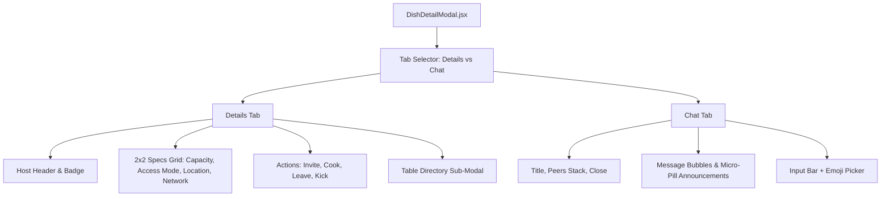

# Dish Tickets & Real-Time Coordination Modal (`client/src/components/dish/`)

> Campus dish ticket card presentation, capacity meters, and dual-tab detail / live group chat modal.

---

## 1. Architecture & Role in System
This directory houses the core coordination components in `LetMeCook`.
- `DishCard.jsx` renders individual activity tickets within the Dine-In and Home feeds.
- `DishDetailModal.jsx` is the primary interactive hub: details view, 2x2 specs grid, action buttons (`Invite`, `Cook`, `Leave`), Table Directory sub-modal, and live group chat feed.

---

## 2. Directory Inventory & Module Responsibilities

| Component File | Role | Key Props & Features |
| :--- | :--- | :--- |
| [`DishCard.jsx`](file:///Users/nvc/Documents/LetMeCook/client/src/components/dish/DishCard.jsx) | Glassmorphic ticket card with capacity badge, host avatar, location pill, and time remaining. | `dish`, `currentUser`, `onClick`, `onViewProfile` |
| [`DishDetailModal.jsx`](file:///Users/nvc/Documents/LetMeCook/client/src/components/dish/DishDetailModal.jsx) | Dual-tab modal (`Details` and `Chat`), 2x2 specs grid, live messaging feed with dynamic emoji sizing, and Table Directory member overlay. | `dish`, `currentUser`, `isOpen`, `onClose`, `onJoin`, `onLeave`, `onCook`, `onViewProfile` |

---

## 3. `DishDetailModal.jsx` Tab Architecture

---

## 4. Key Performance & Aesthetic Standards
- **Dynamic Emoji Scaling**: Single emojis scale to `30px` (2 emojis to `24px`), preventing huge smiley overflow while maintaining chat rhythm.
- **Micro-Pills for Announcements**: System events ("@user joined", "@user was removed") use subtle inline micro-pills (`padding: 3px 10px`, `fontSize: 11px`, `background: rgba(0, 0, 0, 0.04)`).
- **Responsive Table Directory**: Member cards collapse to 28px avatars and 12.5px typography on mobile screens.
