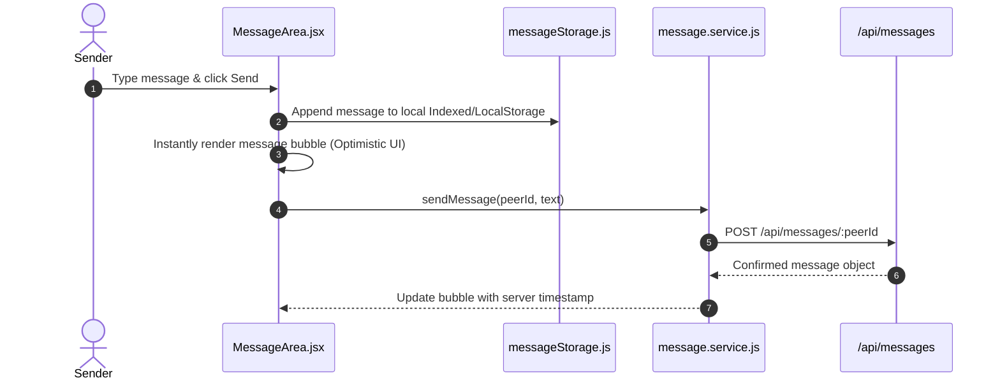

# Direct Messaging System (`client/src/components/messaging/`)

> 1-on-1 direct peer chat, active conversation list, message thread auto-scrolling, and floating emoji selector.

---

## 1. Architecture & Role in System
This directory provides private peer-to-peer messaging (`activeTab === 'messages'`). Once two campus students connect or join a mutual dish, they can coordinate privately via direct messaging.

---

## 2. Directory Inventory & Module Responsibilities

| Component File | Role | Key Props |
| :--- | :--- | :--- |
| [`ConversationList.jsx`](file:///Users/nvc/Documents/LetMeCook/client/src/components/messaging/ConversationList.jsx) | Left conversation column showing recent peer threads, last message preview, unread count badge, and peer avatar. | `conversations`, `activeUserId`, `onSelectConversation` |
| [`MessageArea.jsx`](file:///Users/nvc/Documents/LetMeCook/client/src/components/messaging/MessageArea.jsx) | Right chat window showing thread history, auto-scrolling bubble feed, own/peer alignment, and input bar. | `activePeer`, `messages`, `onSendMessage`, `currentUser` |
| [`EmojiPicker.jsx`](file:///Users/nvc/Documents/LetMeCook/client/src/components/messaging/EmojiPicker.jsx) | Lightweight floating glass emoji picker grid. | `isOpen`, `onClose`, `onSelectEmoji` |

---

## 3. Real-Time Chat & Storage Flow

---

## 4. Performance & Mobile Responsive Rules
- **Optimistic UI**: Messages are appended to local state immediately before network confirmation.
- **Mobile Stack**: On screens `<= 768px`, selecting a conversation switches from the list view to the message view with a back button.
