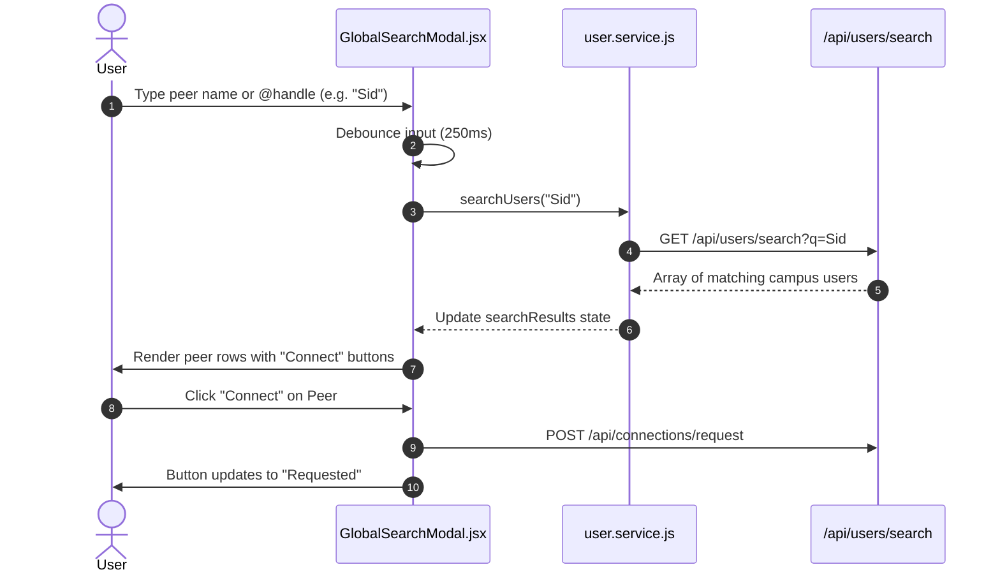

# Global Peer Search Modal (`client/src/components/search/`)

> Instant debounced search modal for finding campus peers, university classmates, and sending connection requests.

---

## 1. Architecture & Role in System
`GlobalSearchModal.jsx` is accessible via the desktop sidebar ("Search") or mobile navigation. It provides debounced, real-time student discovery queried against the backend `/api/users/search` endpoint.

---

## 2. Directory Inventory & Module Responsibilities

| Component File | Role | Key Props |
| :--- | :--- | :--- |
| [`GlobalSearchModal.jsx`](file:///Users/nvc/Documents/LetMeCook/client/src/components/search/GlobalSearchModal.jsx) | Centered glass search modal with auto-focusing input, search history chips, live student result rows, and 1-tap Connect triggers. | `isOpen`, `onClose`, `currentUser`, `onViewProfile` |

---

## 3. Search & Connect Lifecycle

