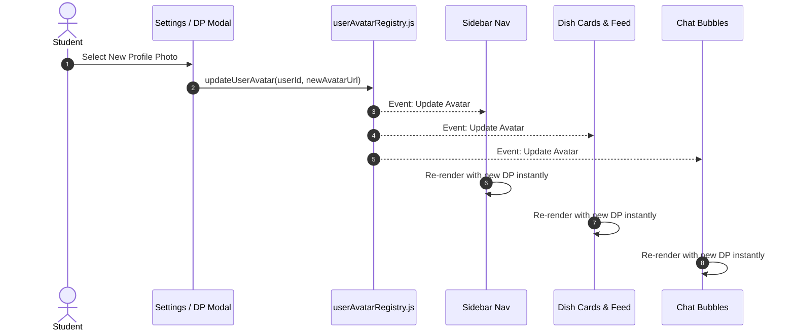

# Client Infrastructure & Core Libraries (`client/src/lib/`)

> Low-level client utilities: HTTP client gateway, reactive global avatar event bus, persistent message cache, and formatters.

---

## 1. Architecture & Role in System
`client/src/lib/` houses foundational utilities supporting the presentation layer. It abstracts browser persistence, network communication, and real-time cross-component sync without pulling in heavy third-party state libraries.

---

## 2. Directory Inventory & Module Responsibilities

| File | Responsibility | Primary Exports |
| :--- | :--- | :--- |
| [`api.js`](file:///Users/nvc/Documents/LetMeCook/client/src/lib/api.js) | Central HTTP client; attaches `Authorization: Bearer <token>`, handles network errors, and intercepts 401s. | `apiClient`, `get`, `post`, `put`, `del` |
| [`userAvatarRegistry.js`](file:///Users/nvc/Documents/LetMeCook/client/src/lib/userAvatarRegistry.js) | Global reactive pub/sub event bus ensuring instant avatar updates across cards, chat bubbles, and headers without page refresh. | `userAvatarRegistry` (`subscribe`, `notify`, `updateUserAvatar`) |
| [`messageStorage.js`](file:///Users/nvc/Documents/LetMeCook/client/src/lib/messageStorage.js) | Persistent client-side caching engine for messaging threads, providing instant chat load times. | `messageStorage` (`saveMessages`, `getMessages`, `clearThread`) |
| [`auth.js`](file:///Users/nvc/Documents/LetMeCook/client/src/lib/auth.js) | Token parsing, token validation, and local credential helpers. | `getToken`, `setToken`, `clearToken` |
| [`utils.js`](file:///Users/nvc/Documents/LetMeCook/client/src/lib/utils.js) | String truncation, relative timestamp formatters, classname concatenators. | `cn`, `formatRelativeTime`, `truncate` |

---

## 3. Reactive Avatar Event Bus (`userAvatarRegistry.js`)

When a user changes their profile photo or custom avatar in Settings, `userAvatarRegistry` notifies all active subscribers across the UI:

