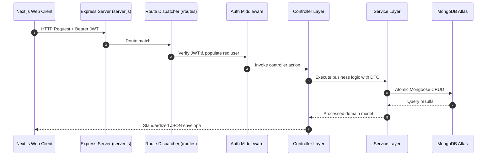

# Server Application Container

> Express.js REST API server engine powering real-time campus dish coordination, authentication, messaging, peer networking, and moderation.

---

## 1. Architecture & Role in System
The `server/` directory encapsulates the backend services for `LetMeCook`. It runs as an independent Node.js process exposing HTTP endpoints consumed by the Next.js frontend client.

- **Port**: Default `5001` (configurable via `PORT` in `.env`).
- **Design Pattern**: 3-Tier Layered Architecture (Routes $\rightarrow$ Controllers $\rightarrow$ Services $\rightarrow$ Mongoose Models).
- **Communication Protocol**: Stateless JSON REST over HTTP, secured with JWT Bearer tokens.

---

## 2. Directory Inventory & Module Responsibilities

| Subfolder / File | Responsibility |
| :--- | :--- |
| [`src/`](file:///Users/nvc/Documents/LetMeCook/server/src) | Main application source code (server entry, routes, controllers, services, models). |
| [`package.json`](file:///Users/nvc/Documents/LetMeCook/server/package.json) | Node package definitions, scripts (`dev`, `start`), dependencies (`express`, `mongoose`, `jsonwebtoken`). |
| [`.env`](file:///Users/nvc/Documents/LetMeCook/server/.env) | Local environment secrets (MongoDB URI, JWT Secret, Port, Client Origin). |

---

## 3. Data Flow & Execution Lifecycle



---

## 4. Environment Variables Specification

| Key | Type | Description | Example |
| :--- | :--- | :--- | :--- |
| `PORT` | Number | Port on which Express server listens | `5001` |
| `NODE_ENV` | String | Runtime environment (`development`, `production`) | `development` |
| `MONGO_URI` | String | MongoDB Atlas connection connection string | `mongodb+srv://...` |
| `JWT_SECRET` | String | Cryptographic key used to sign and verify JWT tokens | `supersecretjwtkey_...` |
| `CLIENT_ORIGIN`| String | Allowed CORS origin for frontend | `http://localhost:3000` |

---

## 5. Developer Workflows & How-Tos

### 1. Installation & Local Development
```bash
cd server
npm install
npm run dev # Launches nodemon watching src/
```

### 2. Production Start
```bash
npm start # Launches with node src/server.js
```

---

## 6. Security & Performance Considerations
- **CORS Protection**: Hardened to accept requests only from `CLIENT_ORIGIN`.
- **Rate Limiting**: Configured across endpoints to prevent brute-force attacks and abuse.
- **Graceful Shutdown**: Unhandled rejections and SIGINT/SIGTERM gracefully close DB connections.
