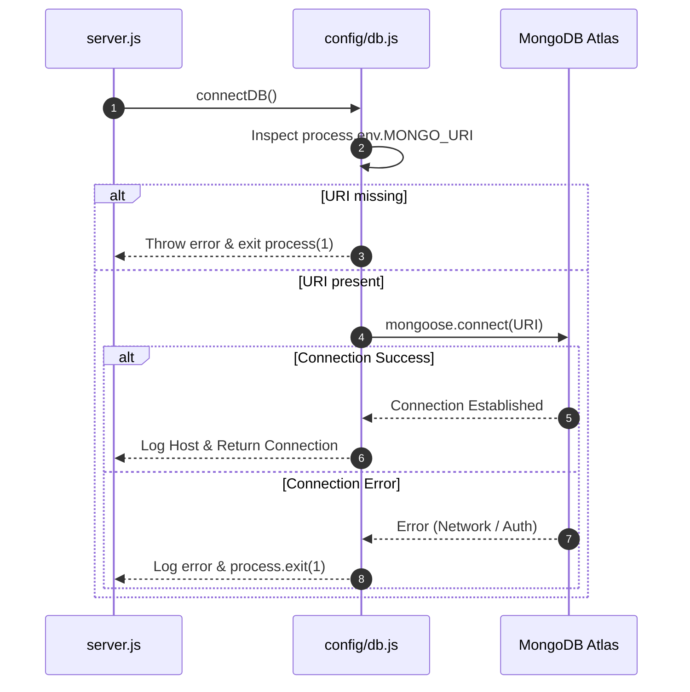

# Infrastructure & Database Configuration (`server/src/config/`)

> Database connection manager, client pooling, and infrastructure environment adapters.

---

## 1. Architecture & Role in System
This folder encapsulates connection management for persistence infrastructure. It ensures that database connection errors fail fast during development and reconnect automatically in production.

---

## 2. Directory Inventory & Module Responsibilities

| File | Responsibility | Primary Exports |
| :--- | :--- | :--- |
| [`db.js`](file:///Users/nvc/Documents/LetMeCook/server/src/config/db.js) | Mongoose MongoDB Atlas connection driver, connection logging, process termination handlers. | `connectDB()` async function |

---

## 3. Connection Lifecycle (`db.js`)

---

## 4. Key Dependencies & Interactions
- **Upstream Caller**: `server.js` calls `connectDB()` before accepting incoming HTTP requests.
- **Underlying Driver**: `mongoose` v9+.
- **Configuration Source**: `process.env.MONGO_URI`.

---

## 5. Security & Gotchas
- **Credentials Leak Prevention**: `MONGO_URI` must never be hardcoded or logged to stdout.
- **Whitelisting**: In MongoDB Atlas, the deployment server IP (or `0.0.0.0/0` for development) must be added to Network Access.
