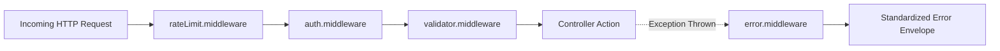

# Server Middleware Layer (`server/src/middleware/`)

> Request interceptors, route guards, token authenticators, rate limiters, payload validators, and global error handlers.

---

## 1. Architecture & Role in System
The middleware layer acts as the security boundary and gateway between incoming HTTP requests and controller execution. Requests that fail authentication, breach rate limits, or contain malformed JSON are intercepted before reaching the business layer.

---

## 2. Directory Inventory & Module Responsibilities

| File | Responsibility | Primary Exports |
| :--- | :--- | :--- |
| [`auth.middleware.js`](file:///Users/nvc/Documents/LetMeCook/server/src/middleware/auth.middleware.js) | JWT extraction (`Bearer <token>`), signature verification, and user document population onto `req.user`. | `authenticateToken` / `protect` |
| [`rateLimit.middleware.js`](file:///Users/nvc/Documents/LetMeCook/server/src/middleware/rateLimit.middleware.js) | IP-based request throttling to prevent DDoS and spam. | `authLimiter`, `apiLimiter`, `dishLimiter` |
| [`validator.middleware.js`](file:///Users/nvc/Documents/LetMeCook/server/src/middleware/validator.middleware.js) | Evaluates `express-validator` schema results, formatting errors into standardized 400 envelopes. | `validateRequest` |
| [`error.middleware.js`](file:///Users/nvc/Documents/LetMeCook/server/src/middleware/error.middleware.js) | Global express error catcher mapping exceptions to HTTP status codes (400, 401, 403, 404, 500). | `errorHandler` |

---

## 3. Middleware Execution Sequence



---

## 4. Public Contracts & Interfaces

### `auth.middleware.js` Contract
- **Header Required**: `Authorization: Bearer <JWT_STRING>`
- **Mutation on Success**: Attaches authenticated user object to `req.user` (`req.user.id`, `req.user.institute`, etc.).
- **Failure Status**:
  - `401 Unauthorized`: Token missing or malformed.
  - `403 Forbidden`: Token invalid or expired.

### `validator.middleware.js` Contract
- Runs after an array of `check()` rules from `express-validator`.
- If validation fails, halts chain immediately with:
  ```json
  {
    "success": false,
    "message": "Validation failed",
    "errors": [{ "field": "email", "message": "Invalid university domain" }]
  }
  ```

---

## 5. How-To: Protecting a New Route

```javascript
const router = require('express').Router();
const { authenticateToken } = require('../middleware/auth.middleware');
const { apiLimiter } = require('../middleware/rateLimit.middleware');
const { validateRequest } = require('../middleware/validator.middleware');
const { body } = require('express-validator');

router.post(
  '/action',
  apiLimiter,
  authenticateToken,
  [body('title').trim().notEmpty().withMessage('Title is required')],
  validateRequest,
  controller.action
);
```
