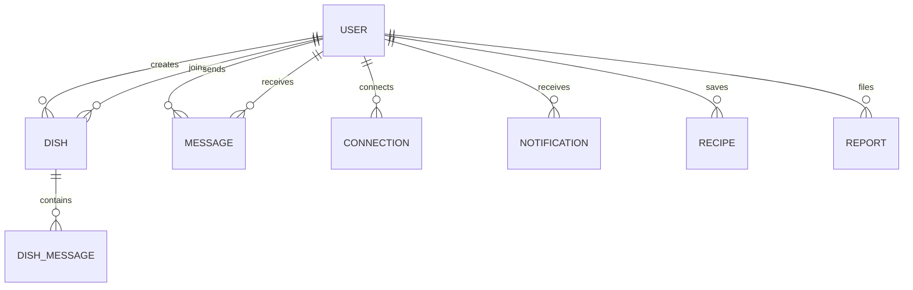

# Mongoose Models & Schemas (`server/src/models/`)

> Data access layer defining MongoDB document schemas, compound indexes, TTL lifecycle rules, and database entity relationships.

---

## 1. Architecture & Role in System
Models define the data contracts, constraints, and relationships for `LetMeCook`. All document mutations pass through Mongoose validators and hooks before persistence in MongoDB Atlas.

---

## 2. Directory Inventory & Module Responsibilities

| Model File | Entity Responsibility | Key Fields | Primary Indexes |
| :--- | :--- | :--- | :--- |
| [`User.js`](file:///Users/nvc/Documents/LetMeCook/server/src/models/User.js) | Student account, credentials, university affiliation, avatar, bio | `email`, `password`, `username`, `institute`, `avatar` | `email: 1` (unique), `username: 1` (unique) |
| [`Dish.js`](file:///Users/nvc/Documents/LetMeCook/server/src/models/Dish.js) | Campus coordination activity ticket | `creator`, `category`, `capacity`, `participants`, `status`, `expiresAt` | `status: 1, institute: 1`, `expiresAt: 1` (TTL) |
| [`DishMessage.js`](file:///Users/nvc/Documents/LetMeCook/server/src/models/DishMessage.js) | Live group chat messages for active dishes | `dish`, `sender`, `content`, `isSystem` | `dish: 1, createdAt: 1` |
| [`Message.js`](file:///Users/nvc/Documents/LetMeCook/server/src/models/Message.js) | 1-on-1 direct peer chat messages | `sender`, `receiver`, `content`, `read` | `sender: 1, receiver: 1, createdAt: 1` |
| [`Connection.js`](file:///Users/nvc/Documents/LetMeCook/server/src/models/Connection.js) | Campus peer connection relationship | `requester`, `recipient`, `status` (`pending`, `accepted`) | `requester: 1, recipient: 1` (unique compound) |
| [`Notification.js`](file:///Users/nvc/Documents/LetMeCook/server/src/models/Notification.js) | User activity notifications and invites | `recipient`, `actor`, `type`, `dish`, `read` | `recipient: 1, read: 1, createdAt: -1` |
| [`Recipe.js`](file:///Users/nvc/Documents/LetMeCook/server/src/models/Recipe.js) | Saved dish templates for quick re-cooking | `user`, `title`, `category`, `capacity`, `location` | `user: 1, createdAt: -1` |
| [`Report.js`](file:///Users/nvc/Documents/LetMeCook/server/src/models/Report.js) | Trust, safety, and community flag reports | `reporter`, `reportedUser`, `reason`, `dish` | `reportedUser: 1, status: 1` |
| [`Verification.js`](file:///Users/nvc/Documents/LetMeCook/server/src/models/Verification.js) | OTP and token store for campus email validation | `email`, `token`, `expiresAt` | `email: 1`, `expiresAt: 1` (TTL index) |

---

## 3. Entity Relationship Diagram

---

## 4. Key Performance & Indexing Strategies
1. **TTL Expiry**: `Dish` documents feature an `expiresAt` field with a background TTL index. When a ticket expires, MongoDB automatically updates or cleans it, ensuring no stale tickets linger in active feeds.
2. **Compound Lookups**: `Connection` enforces `{ requester: 1, recipient: 1 }` with a unique constraint, preventing duplicate requests between the same pair of students.
3. **Partitioned Feeds**: `Dish` queries filter on `{ institute: req.user.institute, status: 'active' }` backed by compound indices for sub-10ms response times.
