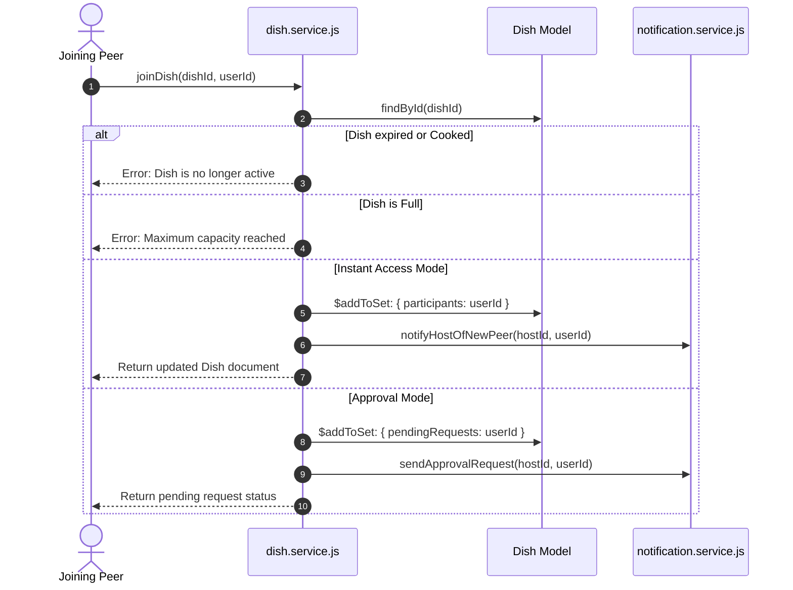

# Business Services Layer (`server/src/services/`)

> Domain business logic, database transaction orchestration, campus validation rules, and inter-entity event side-effects.

---

## 1. Architecture & Role in System
The `services/` layer is the heart of backend business rules. Services are decoupled from Express (`req`, `res` are never passed into services). They accept plain parameters/DTOs, enforce business invariants (e.g. "is the dish full?", "is the student from the same university?"), execute atomic Mongoose operations, and trigger notifications or audit logs.

---

## 2. Directory Inventory & Module Responsibilities

| Service File | Domain Responsibility |
| :--- | :--- |
| [`dish.service.js`](file:///Users/nvc/Documents/LetMeCook/server/src/services/dish.service.js) | Dish creation, radar query filtering, join approval workflows, participant capacity locks, expiration checks, kick/mute actions. |
| [`auth.service.js`](file:///Users/nvc/Documents/LetMeCook/server/src/services/auth.service.js) | Registration, bcrypt hashing/comparison, JWT signing, email domain verification. |
| [`university.service.js`](file:///Users/nvc/Documents/LetMeCook/server/src/services/university.service.js) | Resolving college domains against the 10,000+ university dataset, campus identity validation. |
| [`connection.service.js`](file:///Users/nvc/Documents/LetMeCook/server/src/services/connection.service.js) | Peer connection handshake (request $\rightarrow$ accept/reject), connection status lookup. |
| [`message.service.js`](file:///Users/nvc/Documents/LetMeCook/server/src/services/message.service.js) | Thread message creation, unread counting, dish group chat persistence, system event message emission. |
| [`notification.service.js`](file:///Users/nvc/Documents/LetMeCook/server/src/services/notification.service.js) | Creating activity alerts, invites, connection updates, bulk mark-as-read updates. |
| [`recipe.service.js`](file:///Users/nvc/Documents/LetMeCook/server/src/services/recipe.service.js) | Template storage, retrieval, and conversion into active dish instances. |
| [`safety.service.js`](file:///Users/nvc/Documents/LetMeCook/server/src/services/safety.service.js) | Community safety, user reporting, blocking logic, content moderation flags. |
| [`user.service.js`](file:///Users/nvc/Documents/LetMeCook/server/src/services/user.service.js) | User profile updates, campus peer search with regex/domain matching, avatar mutations. |
| [`email.service.js`](file:///Users/nvc/Documents/LetMeCook/server/src/services/email.service.js) | OTP verification email delivery via Nodemailer/SMTP. |

---

## 3. Dish Join Workflow Sequence (`dish.service.js`)

---

## 4. Design Guidelines for Service Functions
1. **No HTTP Knowledge**: Never reference `req`, `res`, or HTTP status codes inside services. Throw domain `Error` instances instead.
2. **Atomic Writes**: Use MongoDB atomic operators (`$addToSet`, `$pull`, `$inc`, `$set`) to prevent race conditions during concurrent user requests.
3. **Audit Side Effects**: When critical actions occur (e.g. member kicked, invite accepted), call `notification.service` or inject system event messages into the room thread.
